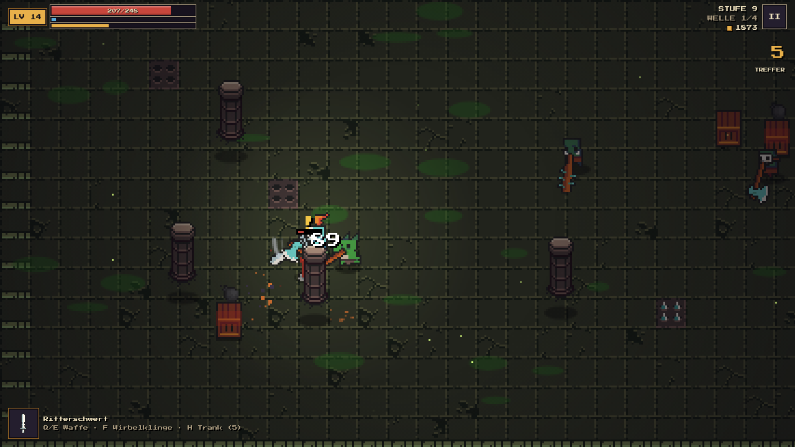
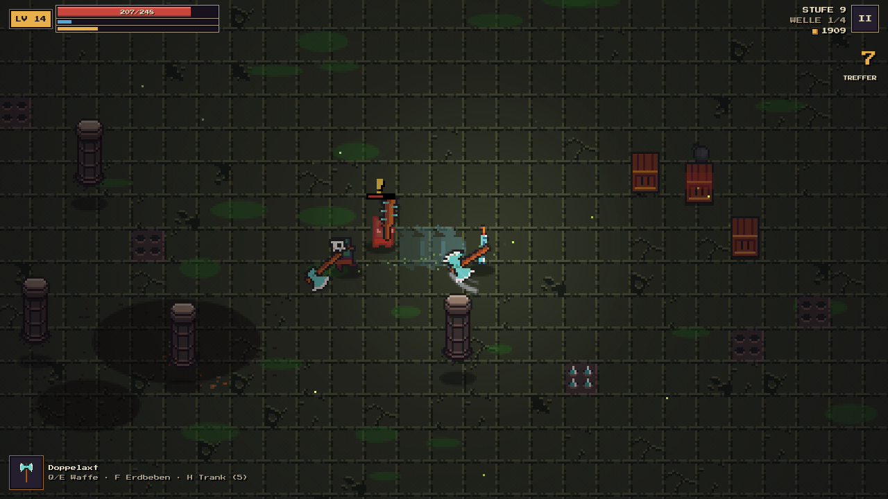
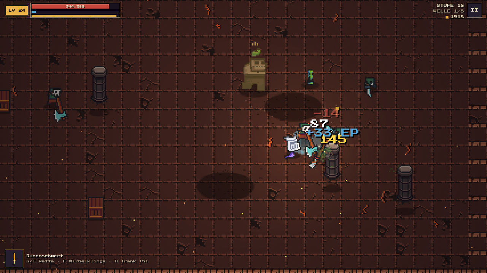
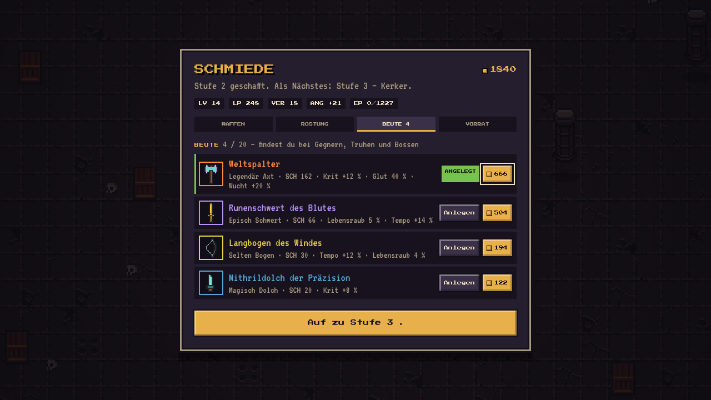
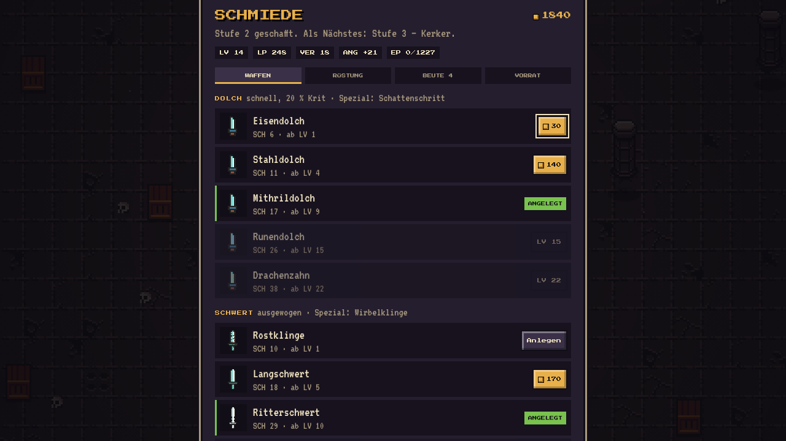
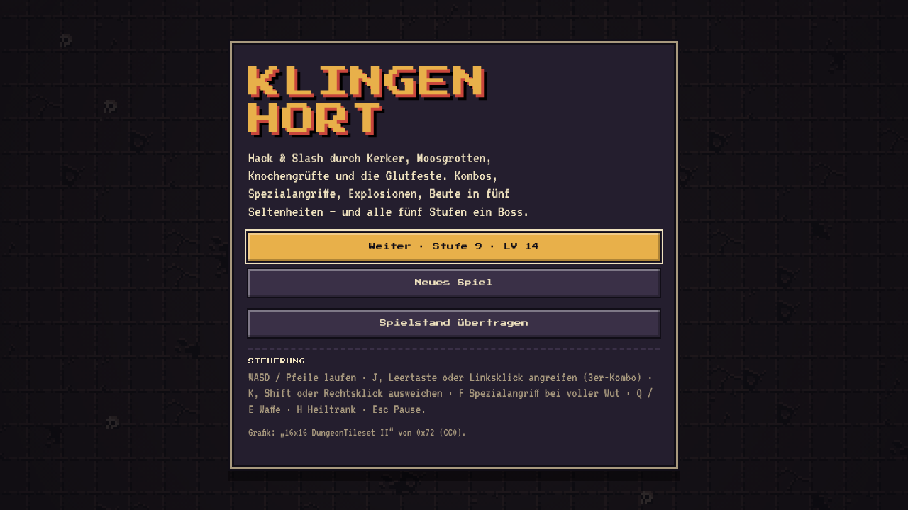

<div align="center">

# ⚔ KLINGENHORT

**16-Bit Hack & Slash im Browser – für Handy (Querformat) und PC.**
Kombos, Spezialangriffe, Explosionen, Beute in fünf Seltenheiten und alle fünf Stufen ein Boss.

### ▶ [Jetzt spielen: katimur94.github.io/klingenhort](https://katimur94.github.io/klingenhort/)

Kostenlos · ohne Anmeldung · als App installierbar · offline spielbar


</div>

---

## Inhalt
- [Screenshots](#screenshots)
- [Features](#features)
- [Steuerung](#steuerung)
- [Waffen & Spezialangriffe](#waffen--spezialangriffe)
- [Rüstung](#rüstung)
- [Beute & Seltenheiten](#beute--seltenheiten)
- [Gegner & Bosse](#gegner--bosse)
- [Gebiete](#gebiete)
- [Als App installieren](#als-app-installieren)
- [Spielstand übertragen](#spielstand-übertragen)
- [Technik](#technik)
- [Werbevideo](#werbevideo)
- [Credits](#credits)

---

## Screenshots

| Kampf mit Kombo-Zähler | Spezialangriff „Erdbeben“ |
|---|---|
|  |  |

| Glutfeste – Explosionen & Fallen | Boss „Höllenschlund Ignaroth“ |
|---|---|
|  |  |

| Schmiede – Beute | Schmiede – Waffen |
|---|---|
|  |  |

| Handy im Querformat mit Touch-Steuerung | Titelbildschirm |
|---|---|
|  |  |

---

## Features

- **Pixel-Art mit 3D-Gefühl** – animierte Sprites, die sich beim Richtungswechsel um die eigene Achse drehen, sich in Laufrichtung neigen, bei Schritten und Treffern stauchen und strecken, mit Schattenwurf und Tiefenstaffelung
- **Kampfsystem** – 3er-Kombos mit Finisher, Wut-Leiste, ein Spezialangriff pro Waffe, Ausweichrolle mit Unverwundbarkeit, Zauberkugeln lassen sich wegschlagen
- **Level-System** – Erfahrungspunkte, Level-Ups mit mehr Lebenspunkten und Angriff; Gegner werden mit jeder Stufe stärker
- **Endlose Stufen** – mehrere Wellen pro Stufe, Elite-Gegner (goldene Krone) ab Stufe 7, alle 5 Stufen ein Boss
- **Ausrüstung** – vier Waffentypen und Rüstung/Helm in je fünf Stufen (Eisen bis Drachen), freigeschaltet über dein Level
- **Beute** – Waffen in fünf Seltenheiten mit Zusatzwerten, Lichtstrahl beim Fallenlassen, automatisches Anlegen besserer Funde
- **Lebendige Arenen** – Säulen, zerschlagbare Kisten, Sprengkisten mit Kettenreaktion, Stachelfallen, Truhen (manchmal ein Mimik)
- **Atmosphäre** – Licht und Schatten, flackernde Fackeln, Lava-Brunnen, Partikel, Bildschirmwackeln, Trefferstopps, Zeitlupe beim Boss-Kill
- **Sound** – Retro-Soundeffekte und Chiptune-Musik pro Gebiet, beim Boss schneller
- **Handy & PC** – Touch-Steuerung mit virtuellem Stick und Auto-Zielen, Tastatur und Maus am PC
- **PWA** – installierbar, Vollbild im Querformat, offline spielbar

---

## Steuerung

| Aktion | Handy | PC |
|---|---|---|
| Laufen | Linke Bildschirmhälfte ziehen | WASD / Pfeiltasten |
| Angreifen (halten = Kombo) | Roter Knopf | J · Leertaste · Linksklick |
| Ausweichrolle | ROLLE | K · Shift · Rechtsklick |
| Spezialangriff (Wut voll) | SPEZ | F · L · Mittelklick |
| Waffe wechseln | WAFFE | Q / E |
| Heiltrank | TRANK | H |
| Pause | II oben rechts | Esc / P |

Angriffe zielen automatisch auf den nächsten Gegner. Am PC zielst du mit der Maus, solange du klickst.

---

## Waffen & Spezialangriffe

| Waffe | Stil | Kombo-Finisher | Spezialangriff |
|---|---|---|---|
| **Dolch** | sehr schnell, 20 % Krit | Doppelstich | **Schattenschritt** – Sprint durch alle Gegner, garantierte Krits |
| **Schwert** | ausgewogen | großer Hieb mit Vorstoß | **Wirbelklinge** – drehende Klinge, trifft alles ringsum |
| **Axt** | langsam, weiter Hieb, starker Rückstoß | Wucht-Hieb | **Erdbeben** – Sprung mit Schockwelle und Explosion |
| **Bogen** | Fernkampf, ab Runen durchschlagend | Dreifachschuss | **Pfeilsturm** – Fächer aus durchschlagenden Pfeilen |

Jede Waffe gibt es in fünf Stufen: **Eisen → Stahl → Mithril → Runen → Drachen**. Die Wut-Leiste füllt sich durch Treffer und Kills.

## Rüstung

| Stufe | Rüstung | Helm | ab Level |
|---|---|---|---|
| 1 | Lederwams | Lederkappe | 1 |
| 2 | Kettenhemd | Eisenhelm | 4–5 |
| 3 | Schuppenpanzer | Federhelm | 8–10 |
| 4 | Plattenrüstung | Runenhelm | 13–15 |
| 5 | Drachenpanzer | Drachenhelm | 20–22 |

Rüstung und Helm verändern das Aussehen des Ritters.

---

## Beute & Seltenheiten

| Seltenheit | Schadensbonus | Zusatzwerte |
|---|---|---|
| ⚪ Gewöhnlich | – | – |
| 🔵 Magisch | +15 % | 1 |
| 🟡 Selten | +30 % | 2 |
| 🟣 Episch | +50 % | 2 |
| 🟠 Legendär | +80 % | 3, eigener Name |

**Zusatzwerte:** Krit · Tempo · Lebensraub · Glut (Brennschaden) · Wucht.
Beute droppen Elite-Gegner, Truhen, Mimiks und Bosse. In der Schmiede kannst du sie anlegen oder verkaufen (max. 20 Stück).

---

## Gegner & Bosse

| Gegner | Verhalten | ab Stufe |
|---|---|---|
| Goblin | Nahkampf mit Messer | 1 |
| Skelettkrieger | Nahkampf mit Schwert | 2 |
| Echsenmensch | Sprungangriff mit Speer | 3 |
| Wogol-Sprengmeister | wirft Bomben | 3 |
| Sumpfschleim | teilt sich beim Tod | 4 |
| Nekromant | Zauberkugeln, beschwört Zombies | 4 |
| Orkkrieger | harter Nahkampf | 5 |
| Oger | Hammerschlag mit Schockwelle | 6 |
| Ork-Berserker | Sturmangriff (kracht gegen Säulen) | 7 |
| Imp | fliegt und stürzt herab | 8 |
| Hornteufel | schneller Sprungangriff | 9 |
| Moderriese | schwerer Stampfer | 11 |
| Mimik | versteckt sich in Truhen | – |

**Bosse** (Stufe 5, 10, 15, dann im Wechsel und immer stärker):
1. **Ogerhäuptling Grausch** – Schockwellen mit Felsbrocken, ruft Goblins
2. **Schamane Vexhal** – Kugel-Salven, teleportiert sich, ruft Orks
3. **Höllenschlund Ignaroth** – Feueratem, Stampf-Explosion, ruft Imps

## Gebiete

| Stufen | Gebiet |
|---|---|
| 1–5 | Kerker |
| 6–10 | Moosgrotte |
| 11–15 | Knochengruft |
| 16–20 | Glutfeste |

Danach wiederholen sich die Gebiete, die Gegner werden weiter stärker.

---

## Als App installieren

- **Android (Chrome):** Seite öffnen → im Titelmenü „Als App installieren“ (oder Chrome-Menü → „App installieren“)
- **iPhone/iPad (Safari):** Teilen → „Zum Home-Bildschirm“
- **PC (Chrome/Edge):** Installieren-Symbol in der Adressleiste

Als App startet das Spiel im Vollbild und im Querformat. Hältst du das Handy hochkant, pausiert das Spiel automatisch.

## Spielstand übertragen

Der Spielstand liegt im Browser des jeweiligen Geräts. Unter **Titelmenü → Spielstand übertragen** bekommst du einen Code, den du auf einem anderen Gerät einfügen kannst.

---

## Technik

- Eine einzige `index.html` mit HTML5-Canvas und reinem JavaScript, keine Abhängigkeiten
- Grafik als eingebettetes Sprite-Sheet; Musik und Soundeffekte werden live mit der Web Audio API erzeugt
- Niedrige interne Auflösung (~200 px Höhe), pixelgenau hochskaliert
- `manifest.webmanifest` + `sw.js` (Service Worker) für Installation und Offline-Betrieb
- Gehostet über GitHub Pages

```
index.html             Spiel
manifest.webmanifest   App-Manifest (Vollbild, Querformat)
sw.js                  Service Worker (Offline-Cache)
icons/                 App-Icons
docs/                  Screenshots, GIF, Werbevideo
```

Lokal starten: Ordner mit einem beliebigen Webserver ausliefern, z. B. `python3 -m http.server`, dann `http://localhost:8000` öffnen.

---

## Werbevideo

Ein 28-Sekunden-Clip im Hochformat (1080×1920) für TikTok und Instagram Reels: [docs/klingenhort_promo.mp4](docs/klingenhort_promo.mp4)


---

## Credits

- Grafik: [16x16 DungeonTileset II](https://0x72.itch.io/dungeontileset-ii) von **0x72** – CC0 (gemeinfrei)
- Schriften: [Press Start 2P](https://fonts.google.com/specimen/Press+Start+2P) und [VT323](https://fonts.google.com/specimen/VT323) – SIL Open Font License
- Spiel, Code, Musik: Timur / katimur94
